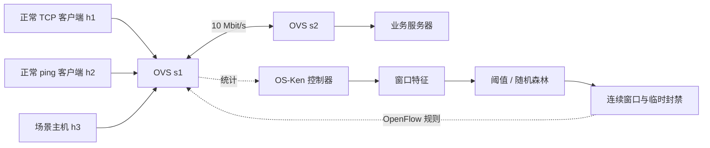
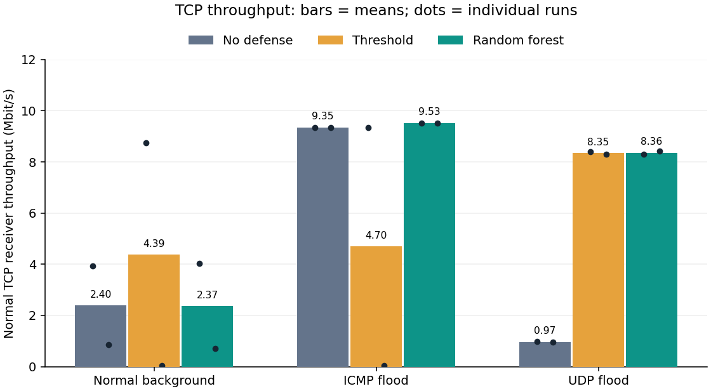
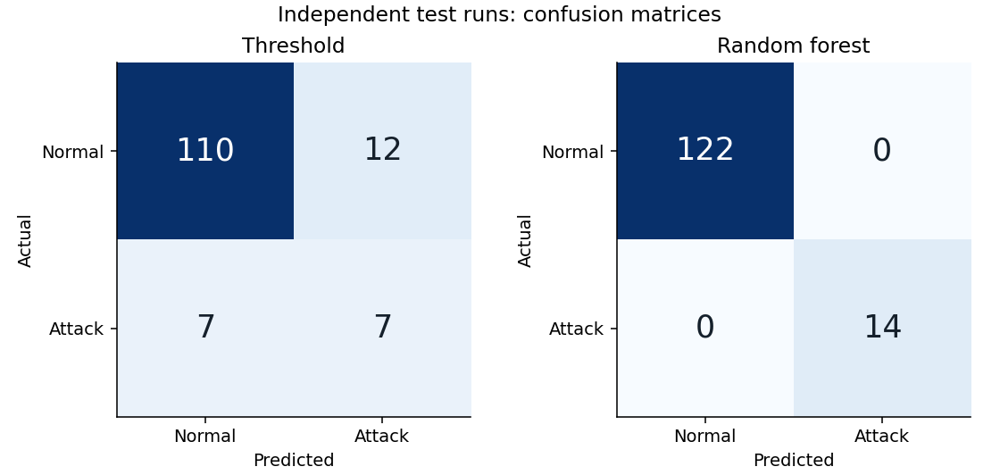
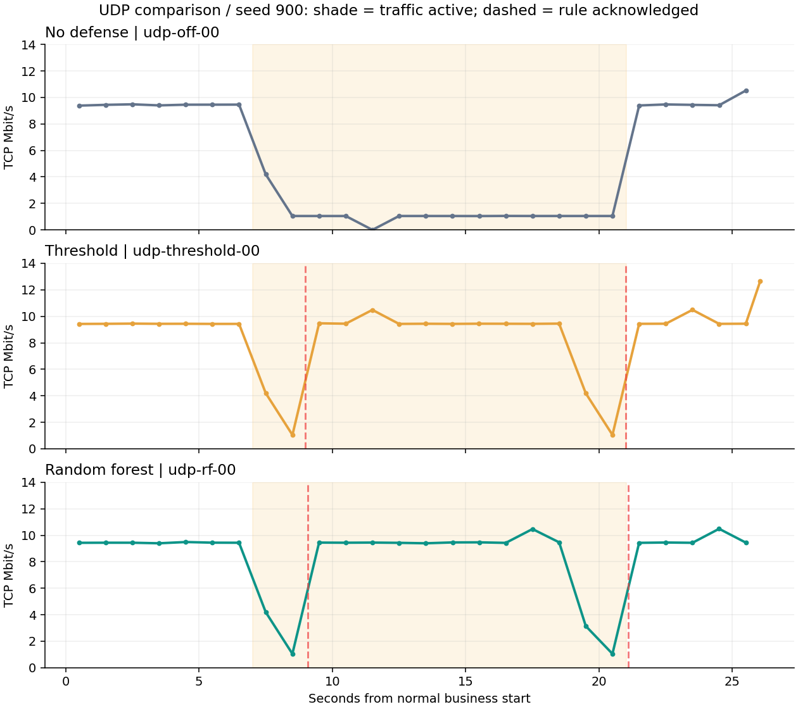

# 基于软件定义网络的智能网络异常检测与动态防御系统

课程：计算机网络课程设计  
姓名 / 学号 / 班级：提交前填写  
实验日期：2026 年 9 月 22 日

## 摘要

本项目设计一个基于软件定义网络的异常流量检测与动态防御系统。使用 Mininet 构建双交换机网络，通过 Open vSwitch 提供 OpenFlow 1.3 转发功能，OS-Ken 控制器周期性获取入口流量统计。系统提取包速率、字节速率、平均包长和协议类别等特征，分别采用包速率阈值和随机森林进行正常/异常二分类。判定连续满足触发条件后，控制器安装具有有效期的高优先级丢弃规则，并利用规则确认、丢弃计数和业务接收吞吐量验证防御闭环。实验按独立轮次划分训练、验证和测试数据，分别评价分类性能与网络防御效果。

关键词：软件定义网络；OpenFlow；Mininet；随机森林；流量异常检测

## 1. 研究背景与设计目标

传统静态转发网络的状态采集和控制策略配置相对分散。SDN 将可编程控制逻辑与数据转发过程分离，为根据实时流量状态调整转发规则提供了实验基础。机器学习可以根据统计特征识别已知流量模式，但离线分类成绩不能直接证明网络中的防御效果。

本项目的目标是完成检测、决策和执行的闭环，并使用独立的业务测量判断防御是否改善正常用户通信。课程设计以可解释、可复现和能够稳定演示为优先目标，不追求模型种类堆叠。

验收内容包括：拓扑互通、统计可追溯、模型训练可复现、规则下发有确认、规则确实产生丢弃、正常业务影响有测量，以及正常流量场景下的误封评估。

## 2. 实验环境与系统架构

宿主机为 Apple Silicon Mac，网络实验运行在专用 Ubuntu 24.04 ARM64 Lima 虚拟机中。虚拟机分配 4 个虚拟 CPU、4 GB 内存和 20 GB 稀疏磁盘。真实使用版本与测试记录保存在项目交付时的环境记录中。

主要软件包括 Mininet 2.3.0、Open vSwitch 3.3.9、Python 3.12.3、iperf3 3.16、OS-Ken 4.2.2、scikit-learn 1.7.2、NumPy 2.2.6 和 iperf3。OS-Ken 通过 `AppManager.run_apps` 启动，不依赖旧版 `osken-manager` 命令。

实验拓扑不接入外部业务网络。所有数据路径和流量产生进程均在实验虚拟机中创建。

## 3. 关键技术与实现

### 3.1 多表转发结构

交换机 table 0 用于检测入口计数与防御，table 1 用于二层学习转发。统计规则优先级为 100，按接入端口、源 IPv4 和协议匹配；命中后增加计数并跳转到 table 1。封禁规则优先级为 400，指令列表为空，阻止对应数据继续转发。没有被专用规则匹配的帧仍按既定默认管线处理。

统计仅针对 s1 上三个客户端入口，避免跨交换机重复计数。预安装固定数量聚合规则，不随连接数量不断增长。

### 3.2 流量特征

每秒通过 OpenFlow 请求统计。对相邻累计计数做差，除以实际时间间隔，得到包速率和字节速率；窗口字节增量除以包数增量得到平均包长。协议采用 ICMP、TCP、UDP 三项独热特征。

首次采样以及计数器下降或规则持续时间回退的窗口不参与速率计算。多部分统计回复全部收齐后才计算本次窗口，超时会留下事件记录。

模型输入不包含源地址和主机编号。地址仅用于控制规则和日志定位，减少模型记住固定攻击主机的问题。

### 3.3 检测模型

基线方法为包速率阈值。随机森林使用 120 棵树、最大深度 8、叶节点最少 2 个样本、平衡类别权重和固定随机种子。模型与特征顺序一并保存，加载时检查特征版本。

阈值方法的包速率阈值、随机森林的概率阈值在验证轮次上选择，以 F1 优先、误报率次之；测试轮次不参与参数选择。

### 3.4 防御与反馈

连续两个窗口预测异常后才发送封禁规则。规则使用 10 秒 `hard_timeout`，并请求 FlowRemoved 通知。封禁范围限定为相应入口、源地址和协议，不直接封禁整个交换机或服务器。

控制器记录规则请求、Barrier 确认和丢弃计数增长三类事件。收到对应 OpenFlow 错误时，不把 Barrier 回复错误地当成成功安装。封禁期间不根据普通统计规则的零流量判断攻击结束。

### 3.5 数据与可视化

原始样本和事件使用 JSONL 保存，元数据记录场景开始/结束时间、参数、随机种子和完成状态。模型数据集导出为 CSV；实验汇总生成 JSON、CSV 和 Markdown。网页看板读取真实日志，展示拓扑、时间回放、入口速率、服务器接收吞吐量和控制事件。

## 4. 实验设计

### 4.1 数据集采集

采集时关闭防御，以免封禁改变样本分布。三类场景分别为正常 UDP 背景流量、ICMP 洪泛、UDP 洪泛，每类 6 轮。每轮都有 h1 正常 TCP 和 h2 正常 ping。异常样本标签根据 h3 的场景类型和实际编排时间确定，边界窗口剔除。

每类前 4 轮为训练集，第 5 轮为验证集，第 6 轮为测试集。样本数量、实际轮次 ID 和数据集 SHA-256 保存在 `models/random_forest.json`。这种划分避免同一轮相邻窗口同时进入训练与测试。

### 4.2 分类性能

评价 Accuracy、Precision、Recall、F1、误报率和混淆矩阵。攻击作为正类。推理耗时对单个测试样本逐次测量，报告均值和 95 分位。

### 4.3 闭环防御

在相同拓扑与相同随机种子的流量参数下，比较无防御、阈值防御和随机森林防御。每个正常/异常场景至少重复两次，执行顺序固定随机打乱以减少顺序影响。

每轮 26 秒，第 7 秒开始场景流量，第 21 秒结束。测量服务端接收的 h1 正常 TCP 业务吞吐量。主比较窗口从场景开始后第 2 秒持续到场景停止，用于检查攻击仍存在时的业务保护效果。正常场景用于评估高负载下的误封。

## 5. 实验结果

实验日期为 2026 年 9 月 22 日。18 轮采集产生 815 个有效窗口，其中训练 543、验证 136、测试 136 个；共有 18 轮独立闭环对照实验。原始数据、逐轮结果和过程日志均随项目提供。

验证集选出的包速率阈值为 500 包/秒，随机森林概率阈值为 0.5。测试集包含 122 个正常窗口与 14 个异常窗口。模型与数据集在闭环对照前冻结，未根据闭环测试结果重新调参。

### 检测效果（独立测试轮次）

| 方法 | Accuracy | Precision | Recall | F1 | 误报率 | 平均推理 ms |
| --- | --- | --- | --- | --- | --- | --- |
| threshold | 0.860 | 0.368 | 0.500 | 0.424 | 0.098 | 0.000094 |
| rf | 1.000 | 1.000 | 1.000 | 1.000 | 0.000 | 0.939525 |

### 正常 TCP 业务吞吐量与响应

测量来自服务端 iperf3 接收区间；单位 Mbit/s。场景期统计从流量开始后第 2 秒到停止，不包含停止后的自然恢复。正常场景的 h3 流量也属于合法背景流量。

| 场景 | 方法 | 轮次 | 基线吞吐量 | 场景期吞吐量（均值 ± 样本标准差） | 检测时延 s | 确认丢弃轮次 | 误封次数均值 |
| --- | --- | --- | --- | --- | --- | --- | --- |
| normal | off | 2 | 9.435 | 2.401 ± 2.179 | 未测得 | — | 0.000 |
| normal | threshold | 2 | 6.374 | 4.387 ± 6.157 | 未测得 | — | 2.500 |
| normal | rf | 2 | 9.433 | 2.374 ± 2.347 | 未测得 | — | 0.000 |
| icmp | off | 2 | 9.614 | 9.352 ± 0.003 | 未测得 | 0/2 | 0.000 |
| icmp | threshold | 2 | 6.290 | 4.697 ± 6.579 | 未测得 | 0/2 | 0.500 |
| icmp | rf | 2 | 9.440 | 9.526 ± 0.003 | 1.898 | 2/2 | 0.500 |
| udp | off | 2 | 9.438 | 0.969 ± 0.011 | 未测得 | 0/2 | 0.000 |
| udp | threshold | 2 | 9.431 | 8.348 ± 0.062 | 1.958 | 2/2 | 0.000 |
| udp | rf | 2 | 9.517 | 8.360 ± 0.081 | 2.033 | 2/2 | 1.000 |

### 5.3 结果解释

本次独立测试中随机森林 F1 为 1.000，阈值方法 F1 为 0.424。这只代表三个保留测试轮次上的结果。训练和测试来自固定拓扑与已知生成器，正常 UDP 的载荷为 512/900/1200 字节，异常 UDP 为 128/192/256/384 字节，存在很明显的包长差异，因此分类任务相对容易。不能将本次成绩外推为真实网络或未知攻击的准确率。

UDP 场景中，无防御的正常 TCP 平均接收吞吐量为 0.969 Mbit/s，随机森林防御为 8.360 Mbit/s。该指标在场景仍持续期间统计，说明收益并非仅来自异常流量自然停止。每组只有两轮，表中同时保留波动范围，不做统计显著性宣称。

正常背景场景中，无防御和随机森林的正常 TCP 吞吐量分别为 2.401 和 2.374 Mbit/s。合法 UDP 也会竞争瓶颈带宽，因此吞吐量降低本身不是攻击的证明；阈值封禁合法流量后即使 TCP 吞吐量升高，也不能视为正确防御。

随机森林在 4 轮异常场景中，有 4 轮确认真实丢弃；2 轮纯正常场景中记录到 0 次封禁。按“非目标源、错误协议或场景时段外确认规则均计入”的严格口径，随机森林全部轮次合计 3 次误封/场景外封禁。逐轮记录见 `artifacts/results.csv`，应将场景结束后的延迟动作与直接误封正常客户端区分分析。离线分类成绩不能替代控制时序的评估。

进一步核对后，随机森林的非目标源/错误协议封禁为 0 次，目标正确但场景时段外的封禁为 3 次。这些窗口统计存在采样延迟，场景刚结束时仍可能依据之前的异常窗口下发规则；本次报告保留这一时间边界问题，没有通过更改统计窗口去消除它。

图 1：场景持续期正常 TCP 接收吞吐量，柱为两轮均值，黑点为每轮实际测量；样本标准差保留在上表。

图 2：行是真实标签，列是预测标签；正类为异常。样本单位是一秒左右的统计窗口。

图 3：固定采用 seed=900 的三种方法，阴影表示场景流量持续，虚线表示规则确认；没有挑选最优轮次作图。

### 5.4 证据与复现

- 原始日志：`artifacts/collection/` 与 `artifacts/benchmark/`。
- 统计结果：`artifacts/results.json`、`artifacts/results.csv`。
- 数据集与划分：`models/dataset.csv`、`models/random_forest.json`。
- 环境版本、依赖清单、代码/模型校验值及验收：`docs/verification/`。
- 开发和实验过程：[开发与实验日志](开发与实验日志.md)。

模型推理时间、从场景开始到请求封禁的检测时延、规则确认耗时，以及首次观测丢弃的时刻使用不同口径。检测失败的轮次没有零时延成绩，而是保留缺失值并展示未确认丢弃。CPU 共享、虚拟机时间同步与进程启动偏差限制了时间测量精度，不能用本系统宣称毫秒级端到端响应。

## 6. 讨论与局限

一秒采样与连续两个窗口判定带来秒级响应延迟，模型推理耗时不能替代端到端时延。Barrier 确认与首次观测丢弃之间仍有轮询间隔，后者是离散采样下的观测值。

训练数据和测试数据虽然按轮次隔离，但仍来自同一拓扑和有限的生成方式。实验仅验证已知 ICMP/UDP 洪泛，不支持关于未知攻击检测、真实互联网准确率或生产规模的结论。Mininet 主机共享虚拟机资源，也会受到宿主机负载影响。

本实现固定接入端口与源 IP 对应，不覆盖地址伪造、动态迁移和复杂多租户环境。后续可以增加扫描的新连接统计、TCP 标志计数、更多正常业务、跨拓扑测试与限速策略，但这些属于扩展工作。

## 7. 总结

项目实现了流量采集、特征计算、分类决策、规则安装和业务效果测量的完整实验链条。其课程价值在于将数据链路层转发、网络性能指标和可编程控制结合起来，并以可追溯证据评价系统。最终效果以实际日志和统计结果为准。

## 参考资料

1. [Mininet Walkthrough](https://mininet.org/walkthrough/)
2. [OS-Ken Application API](https://docs.openstack.org/os-ken/latest/os_ken_app_api.html)
3. [Open vSwitch Documentation](https://docs.openvswitch.org/en/latest/)
4. [scikit-learn RandomForestClassifier](https://scikit-learn.org/stable/modules/generated/sklearn.ensemble.RandomForestClassifier.html)
5. [Lima Documentation](https://lima-vm.io/docs/)
